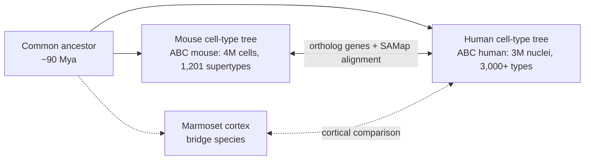
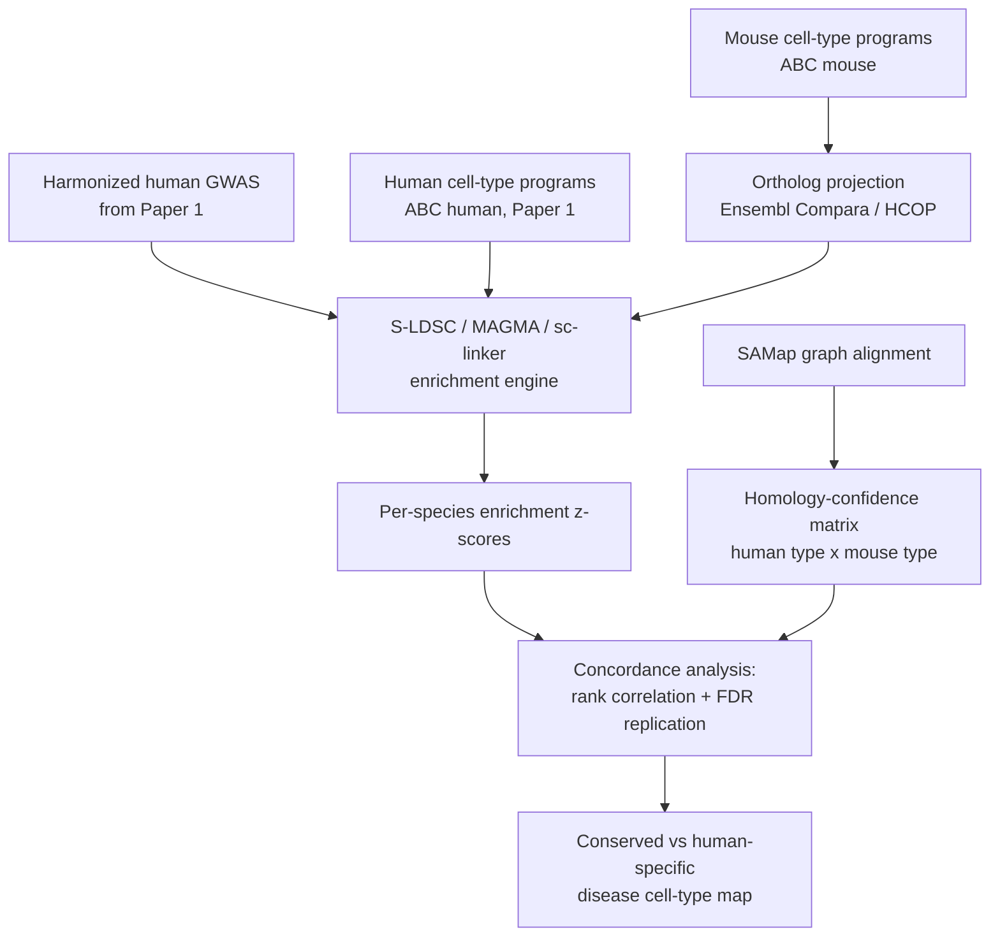
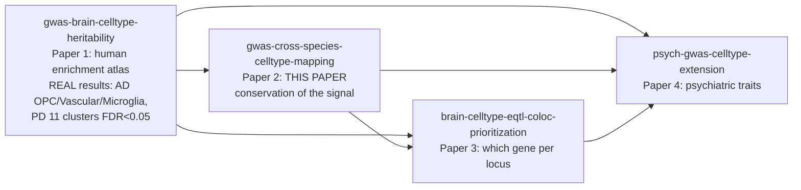

# Extended Introduction — Paper 2: Cross-Species Conservation of Brain Cell-Type Heritability

**Builds on:** Paper 1 (`gwas-brain-celltype-heritability`), which supplies the harmonized GWAS summary statistics, human cell-type gene programs, and the enrichment pipeline. **Consumed by:** Papers 3 and 4 (`brain-celltype-eqtl-coloc-prioritization`, `psych-gwas-celltype-extension`), which reuse this paper's concordance framework. **Paper 1 already has real results:** FinnGen R11 Alzheimer's disease (AD) heritability concentrated in oligodendrocyte precursor cells (OPC, z = 5.73), vascular cells (z = 5.51), and microglia (z = 3.84), and Parkinson's disease (PD) heritability enriched in 11 cell clusters at FDR < 0.05 (top: CA4_197, p = 5.3e-13), all using ABC Atlas marker programs. Paper 2 asks: do those same signals exist in the *mouse* versions of those cell types?

**Audience:** this document assumes zero biology background.

## The sixty-second version

Humans get Alzheimer's and Parkinson's disease partly because of tiny spelling differences in their DNA. Paper 1 showed these spelling differences cluster in specific brain cell types — the risk is not spread evenly across all cells. But most lab science is done on mice, not humans. So a practical question follows: is the mouse version of, say, a human microglia cell actually the *same thing*? If yes, mouse experiments on that cell type teach us about human disease. If no, billions of dollars of mouse research may be studying the wrong cell. This paper builds the map that answers that question, cell type by cell type, across the whole brain.

## What is a cell type, and why do we compare them across species?

Your brain is not one kind of cell. It contains thousands of distinguishable cell populations: neurons that excite, neurons that inhibit, support cells (astrocytes), immune cells (microglia), insulation-making cells (oligodendrocytes) and their precursors (OPCs), blood-vessel cells, and many more. Modern "single-cell" technology reads which genes each individual cell has switched on, producing a fingerprint per cell. Clustering millions of these fingerprints yields a taxonomy — a tree of cell types, from broad classes ("neuron") down to extremely fine types ("CA4_197", one of Paper 1's PD hits). The Allen Brain Cell (ABC) Atlas provides matched versions of this tree: ~3 million human nuclei in >3,000 types [6], and ~4 million mouse cells in 1,201 supertypes [7].

Why compare across species at all? Three reasons:

1. **Translation.** Drugs are tested in mice before humans. If a disease's genetic risk lives in a cell type that mouse lacks — or whose mouse "equivalent" works differently — a mouse experiment on that cell can produce confidently wrong answers. This is a plausible contributor to the poor translational record of brain drug development.
2. **Evolutionary conservation.** Branches of the cell-type tree that survive ~90 million years of human–mouse evolution are probably load-bearing. Finding that AD risk lands in a *conserved* microglial program strengthens the case that the program is causally important, not a human quirk.
3. **Human specificity.** Some human traits (language, long cortical development) involve cell populations expanded or rewired in humans [8]. Finding where disease signal is human-specific tells us where animal models fundamentally cannot help — and where human-cell models are required.

## What does "homologous cell type" mean?

Two genes in two species are **orthologs** if they descend from the same gene in the common ancestor — like the same word inherited into two daughter languages. Databases (Ensembl Compara, HCOP) list these pairs.

A **homologous cell type** is the same idea one level up: a mouse cell type and a human cell type are homologous if they descend from the same ancestral cell population. We can't sequence the ancestor, so we infer homology from gene expression: if a mouse type and a human type both switch on the orthologs of the same marker genes, they are probably the "same" cell. This is exactly like reconstructing that Latin is the ancestor of French and Spanish by comparing word lists — you never see Latin, but the correspondences are systematic.

Two caveats we keep explicit:

- Homology is a matter of **degree and granularity**. Broad classes ("inhibitory neuron") are deeply conserved; fine types often are not [8]. Our analyses therefore run at every level of the taxonomy tree, so we can locate the level where agreement breaks.
- Expression-based homology is **transcriptional** homology. Two cells can express similar genes while their regulatory DNA (the "switches") has diverged. Since disease risk mostly acts on switches, that distinction matters — see Scope.

## What the disease data say (and what we test)

A GWAS (genome-wide association study) scans millions of DNA positions and reports, for each, a number saying how strongly that position's spelling correlates with disease. Most risk spellings sit not inside genes but in the switches that control *where and when* genes turn on. Paper 1 exploited this: take the set of genes that define a human cell type, ask whether DNA near those genes carries a disproportionate share of disease risk ("heritability enrichment"), and repeat for all >3,000 types. Result: AD risk concentrates in OPCs, vascular cells, and microglia; PD risk concentrates in 11 fine neuronal clusters.

The cross-species twist: GWAS variants are *human* variants, so there is no such thing as running the GWAS "in mouse". Instead we test conservation at the **gene-program level**: take the genes specific to each *mouse* cell type, map them to their human orthologs, and ask whether *those* human genes carry excess disease heritability — using the identical pipeline as Paper 1. If mouse-microglia genes (via their human orthologs) show AD enrichment just as human-microglia genes do, the signal is conserved. If a strong human enrichment has no mouse counterpart, we flag a human-specific disease cell type [4,5].

## Key formulas in plain sentences

**1. SAMap / ortholog mapping score.** SAMap [9] aligns two atlases by scoring each human–mouse cell-type pair by how well their gene-expression neighborhoods agree through the ortholog graph; its alignment score is, in plain terms, *"the average similarity of a cell's neighbors after projecting both datasets into one shared space built from orthologous genes"* — high score means the two types sit in matching neighborhoods on both sides. (Gene-set overlap intuition: StatQuest, "Gene Set Enrichment": https://www.youtube.com/watch?v=KY4kEcDwIXE ; graph/embedding intuition: 3Blue1Brown, "Neural networks / embeddings" series: https://www.3blue1brown.com/topics/neural-networks)

**2. Enrichment z-score.** Paper 1's engine asks: "does this gene set carry more heritability than chance?" The z-score is *"the observed excess heritability divided by how much that excess would wobble by chance alone"* — z ≈ 6 (like OPC in AD) means the excess is six wobble-units above zero, essentially impossible as luck. (P-values and z-scores: Seeing Theory, "Basic Probability / Inference": https://seeing-theory.brown.edu ; StatQuest, "P-values": https://www.youtube.com/watch?v=vemZtEM63GY)

**3. Concordance correlation.** We summarize cross-species agreement with a weighted rank correlation: *"do the cell types ranked most disease-relevant in humans keep the same rank order among their mouse homologs, with confident homolog pairs counting more?"* (Correlation intuition: Seeing Theory, "Regression/Correlation": https://seeing-theory.brown.edu)

## Where this paper sits in the series

## Prior work, briefly

Skene et al. mapped schizophrenia risk onto brain cell types using both human and mouse references, implicitly assuming the two mostly agree [5]. Bryois et al. found broad human–mouse agreement for several brain traits [4]. A landmark comparison of human, marmoset, and mouse motor cortex showed major cell classes are deeply conserved but fine types — especially non-neuronal ones — diverge noticeably [8]. What nobody has done: quantify, for the specific cell types carrying human AD/PD risk at whole-brain, >3,000-type resolution, whether the homologous mouse types carry the same signal. That is the gap this paper fills.

## Scope and honesty box

- Conservation here is statistical, at the gene-program level; no animals are touched.
- Ortholog projection drops species-specific genes and all regulatory-sequence divergence, so we test conservation of *transcriptional programs*, not of the enhancer switches themselves — a bound on sensitivity we state, not hide.
- GWAS inputs are European-ancestry human data; results may not transfer to other ancestries.

## References

References are shared with `docs/INTRODUCTION.md`; numbers below match that file.

1. Finucane HK, et al. *Nature Genetics* 47:1228–1235 (2015). doi:10.1038/ng.3404
2. de Leeuw CA, et al. *PLoS Computational Biology* 11:e1004219 (2015). doi:10.1371/journal.pcbi.1004219
3. Jagadeesh KA, et al. *Nature Genetics* 54:1479–1492 (2022). doi:10.1038/s41588-022-01187-9
4. Bryois J, et al. *Nature Genetics* 52:482–493 (2020). doi:10.1038/s41588-020-0610-9
5. Skene NG, et al. *Nature Genetics* 50:825–833 (2018). doi:10.1038/s41588-018-0129-5
6. Siletti K, et al. *Science* 382:eadd7046 (2023). doi:10.1126/science.add7046
7. Yao Z, et al. *Nature* 624:317–332 (2023). doi:10.1038/s41586-023-06812-z
8. Bakken TE, et al. *Nature* 598:111–119 (2021). doi:10.1038/s41586-021-03465-8
9. Tarashansky AJ, et al. *eLife* 10:e66747 (2021). doi:10.7554/eLife.66747
10. Bellenguez C, et al. *Nature Genetics* 54:412–436 (2022). doi:10.1038/s41588-022-01024-9
11. Nalls MA, et al. *The Lancet Neurology* 18:1091–1102 (2019). doi:10.1016/S1474-4422(19)30320-5
12. Trubetskoy V, et al. *Nature* 604:502–508 (2022). doi:10.1038/s41586-022-04434-5
13. Wray NR, et al. *Nature Genetics* 50:668–681 (2018). doi:10.1038/s41588-018-0090-3
14. Finucane HK, et al. *Nature Genetics* 50:621–629 (2018). doi:10.1038/s41588-018-0081-4
