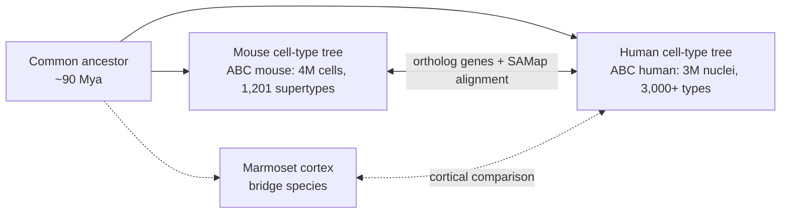
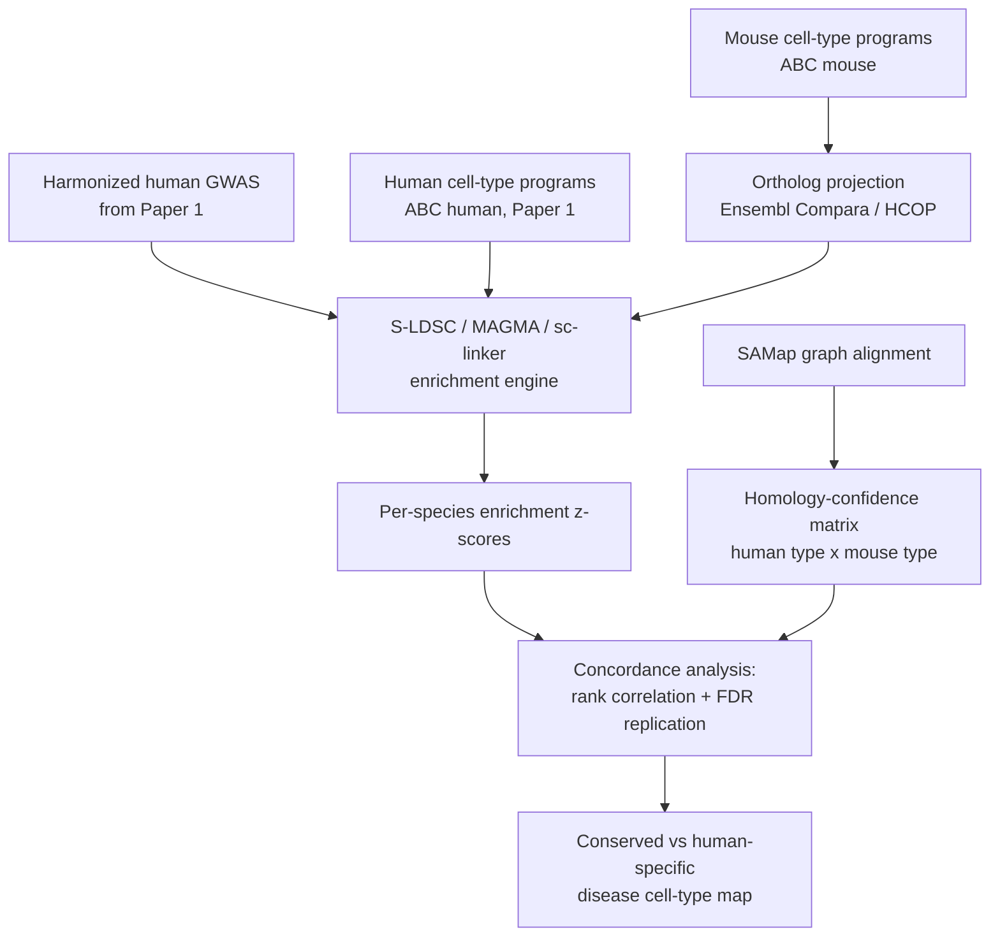
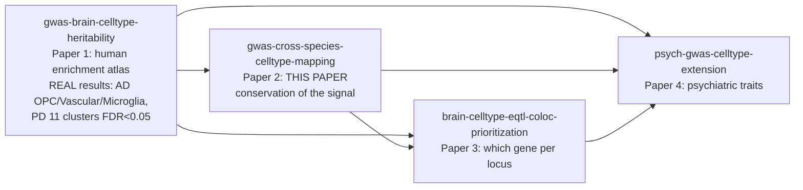

# Extended Introduction — Paper 2: Cross-Species Conservation of Brain Cell-Type Heritability

*A no-prerequisites walkthrough. Every technical idea is first shown on a tiny made-up example you can verify by hand.*

**Builds on:** Paper 1 (`gwas-brain-celltype-heritability`), which supplies the harmonized GWAS summary statistics, human cell-type gene programs, and the enrichment pipeline. **Consumed by:** Papers 3 and 4 (`brain-celltype-eqtl-coloc-prioritization`, `psych-gwas-celltype-extension`), which reuse this paper's concordance framework. **Paper 1 already has real results:** FinnGen R11 Alzheimer's disease (AD) heritability concentrated in oligodendrocyte precursor cells (OPC, z = 5.73), vascular cells (z = 5.51), and microglia (z = 3.84), and Parkinson's disease (PD) heritability enriched in 11 cell clusters at FDR < 0.05 (top: CA4_197, p = 5.3e-13), all using ABC Atlas marker programs. Paper 2 asks: do those same signals exist in the *mouse* versions of those cell types?

*Concept figure: the Paper 2 design in one picture. (Mermaid-renderable version: [figures/concept_figure.md](figures/concept_figure.md).)*

## The sixty-second version

Humans get Alzheimer's and Parkinson's disease partly because of tiny spelling differences in their DNA. Paper 1 showed these spelling differences cluster in specific brain cell types — the risk is not spread evenly across all cells. But most lab science is done on mice, not humans. So: is the mouse version of, say, a human microglia cell actually the *same thing*? If yes, mouse experiments on that cell type teach us about human disease. If no, mouse research may study the wrong cell. This paper builds the map that answers that question, cell type by cell type, across the whole brain.

## The two ingredients, built from scratch

**Ingredient 1: what a GWAS measures.** A GWAS (genome-wide association study) is one simple comparison repeated millions of times. Here is the whole idea on six made-up people, one DNA position, and one trait:

| Person | Genotype (copies of letter G) | Trait score |
|---|---|---|
| 1 | 0 | 50 |
| 2 | 0 | 52 |
| 3 | 1 | 55 |
| 4 | 1 | 57 |
| 5 | 2 | 61 |
| 6 | 2 | 63 |

Each extra G copy comes with a higher score (group averages: 51, 56, 62). That slope is an **association**. A real GWAS does this at millions of positions with hundreds of thousands of people, and reports per position two numbers you can now read: an **effect size** (the slope — how much the trait shifts per copy) and a **z-score** (the slope divided by how wobbly it is — with 6 people the slope is a guess, with 500,000 it is solid; dividing "how big" by "how shaky" tells you how surprised to be). Most risk spellings sit not inside genes but in the *switches* that control where and when genes turn on — which is why the answer to "what does this DNA do?" is always cell-type-specific.

**Ingredient 2: what "enrichment" measures.** Paper 1's core test fits in one toy table. Suppose each gene has a disease score (built from the GWAS z-scores of the spelling variants in its neighborhood — bigger means more disease association):

| Gene | Disease score | Microglia marker? |
|---|---|---|
| A | 9.1 | yes |
| B | 8.7 | yes |
| C | 7.9 | yes |
| D | 6.2 | no |
| E | 5.8 | no |
| F | 5.1 | no |
| G | 4.9 | no |
| H | 4.4 | no |

The markers sit on top (average 8.6 vs. 5.3). **Heritability enrichment** is exactly this — "this cell type's signature genes carry a disproportionate share of disease signal" — scaled by how surprising it is, giving one z-score per cell type [1,2,14]. Run for all >3,000 human cell types, this produced Paper 1's atlas. And a guardrail: with thousands of cell types tested, some would look impressive by luck (flip 436 coins and one will land heads 8 times running); the **FDR q-value** estimates what fraction of any "hits" list is expected to be such luck, and "FDR < 0.05" caps it at about 5%.

## Cell types, and comparing them across species

Modern single-cell technology reads which genes each individual cell has switched on — a fingerprint per cell. Clustering millions of fingerprints yields a taxonomy: a tree of cell types from broad classes ("neuron") down to extremely fine types ("CA4_197", one of Paper 1's PD hits). The Allen Brain Cell (ABC) Atlas provides matched trees: ~3 million human nuclei in >3,000 types [6], and ~4 million mouse cells in 1,201 supertypes [7].

Why compare across species?

1. **Translation.** Drugs are tested in mice before humans. If a disease's risk lives in a cell type that mouse lacks — or whose mouse "equivalent" works differently — a mouse experiment on that cell can produce confidently wrong answers.
2. **Evolutionary conservation.** Cell types that survive ~90 million years of human–mouse evolution are probably load-bearing; AD risk landing in a *conserved* microglial program strengthens the case it is causal.
3. **Human specificity.** Where disease signal is human-specific, animal models fundamentally cannot help and human-cell models are required [8].

## What does "homologous cell type" mean? A word-list example

Two genes in two species are **orthologs** if they descend from the same gene in the common ancestor — like the same word inherited into two daughter languages. Databases (Ensembl Compara, HCOP) list these pairs. You can reconstruct the idea with languages:

| Latin (never observed directly) | French | Spanish |
|---|---|---|
| — | lait | leche |
| — | nuit | noche |
| — | huit | ocho |

Nobody gave you Latin; the systematic correspondences (lait/leche, nuit/noche) tell you these are "the same word" in two daughter languages. **Ortholog mapping** is this table for ~20,000 genes. A **homologous cell type** is the same idea one level up: if a mouse type and a human type both switch on the orthologs of the same marker genes, they are probably the "same" cell. SAMap [9] automates exactly this: it aligns the two atlases by scoring each human–mouse pair on how well their gene-expression neighborhoods agree through the ortholog graph — in plain terms, *"the average similarity of a cell's neighbors after projecting both datasets into one shared space built from orthologous genes."*

Two caveats we keep explicit:

- Homology is a matter of **degree and granularity**. Broad classes ("inhibitory neuron") are deeply conserved; fine types often are not [8]. So we run every analysis at every level of the tree, to locate where agreement breaks.
- Expression-based homology is **transcriptional** homology. Two cells can express similar genes while their regulatory switches have diverged — and disease risk mostly acts on switches. See Scope.

## What we actually test

GWAS variants are *human* variants, so there is no such thing as running the GWAS "in mouse." Instead we test conservation at the **gene-program level**: take the genes specific to each *mouse* cell type, map them to their human orthologs (the word-list table), and ask whether *those* human genes carry excess disease heritability — using the identical enrichment test as Paper 1. If mouse-microglia genes, via their human orthologs, show AD enrichment just as human-microglia genes do, the signal is conserved. If a strong human enrichment has no mouse counterpart despite adequate power, we flag a human-specific disease cell type [4,5].

**Concordance, as a toy example.** Suppose human enrichment ranks five cell types Microglia > OPC > Astrocyte > ExcNeuron > InhNeuron, and the mouse homologs rank Microglia > Astrocyte > OPC > ExcNeuron > InhNeuron. Same names near the top, one swap — high agreement. We summarize this with a **rank correlation** (a number from −1 to 1 measuring how well two rankings agree), weighted so that confident homolog pairs count more. Near +1: the mouse ordering mirrors the human one and mouse models are on solid ground; near 0: ordering does not survive the species jump.

## Where this paper sits in the series

## Prior work, briefly

Skene et al. mapped schizophrenia risk onto brain cell types using both human and mouse references, implicitly assuming the two mostly agree [5]. Bryois et al. found broad human–mouse agreement for several brain traits [4]. A landmark comparison of human, marmoset, and mouse motor cortex showed major cell classes are deeply conserved but fine types — especially non-neuronal ones — diverge noticeably [8]. What nobody has done: quantify, for the specific cell types carrying human AD/PD risk at whole-brain, >3,000-type resolution, whether the homologous mouse types carry the same signal. That is the gap this paper fills.

## Learning links for the ideas above

- Gene sets and enrichment intuition: StatQuest, "Gene Set Enrichment": https://www.youtube.com/watch?v=KY4kEcDwIXE
- Graph/embedding intuition (for SAMap's shared space): 3Blue1Brown, neural networks series: https://www.3blue1brown.com/topics/neural-networks
- P-values and z-scores: Seeing Theory: https://seeing-theory.brown.edu ; StatQuest, "P-values": https://www.youtube.com/watch?v=vemZtEM63GY

## Scope and honesty box

- Conservation here is statistical, at the gene-program level; no animals are touched.
- Ortholog projection drops species-specific genes and all regulatory-sequence divergence, so we test conservation of *transcriptional programs*, not of the enhancer switches themselves — a bound on sensitivity we state, not hide.
- GWAS inputs are European-ancestry human data; results may not transfer to other ancestries.

## References

References are shared with `docs/INTRODUCTION.md`; numbers below match that file.

1. Finucane HK, et al. *Nature Genetics* 47:1228–1235 (2015). doi:10.1038/ng.3404
2. de Leeuw CA, et al. *PLoS Computational Biology* 11:e1004219 (2015). doi:10.1371/journal.pcbi.1004219
3. Jagadeesh KA, et al. *Nature Genetics* 54:1479–1492 (2022). doi:10.1038/s41588-022-01187-9
4. Bryois J, et al. *Nature Genetics* 52:482–493 (2020). doi:10.1038/s41588-020-0610-9
5. Skene NG, et al. *Nature Genetics* 50:825–833 (2018). doi:10.1038/s41588-018-0129-5
6. Siletti K, et al. *Science* 382:eadd7046 (2023). doi:10.1126/science.add7046
7. Yao Z, et al. *Nature* 624:317–332 (2023). doi:10.1038/s41586-023-06812-z
8. Bakken TE, et al. *Nature* 598:111–119 (2021). doi:10.1038/s41586-021-03465-8
9. Tarashansky AJ, et al. *eLife* 10:e66747 (2021). doi:10.7554/eLife.66747
10. Bellenguez C, et al. *Nature Genetics* 54:412–436 (2022). doi:10.1038/s41588-022-01024-9
11. Nalls MA, et al. *The Lancet Neurology* 18:1091–1102 (2019). doi:10.1016/S1474-4422(19)30320-5
12. Trubetskoy V, et al. *Nature* 604:502–508 (2022). doi:10.1038/s41586-022-04434-5
13. Wray NR, et al. *Nature Genetics* 50:668–681 (2018). doi:10.1038/s41588-018-0090-3
14. Finucane HK, et al. *Nature Genetics* 50:621–629 (2018). doi:10.1038/s41588-018-0081-4
