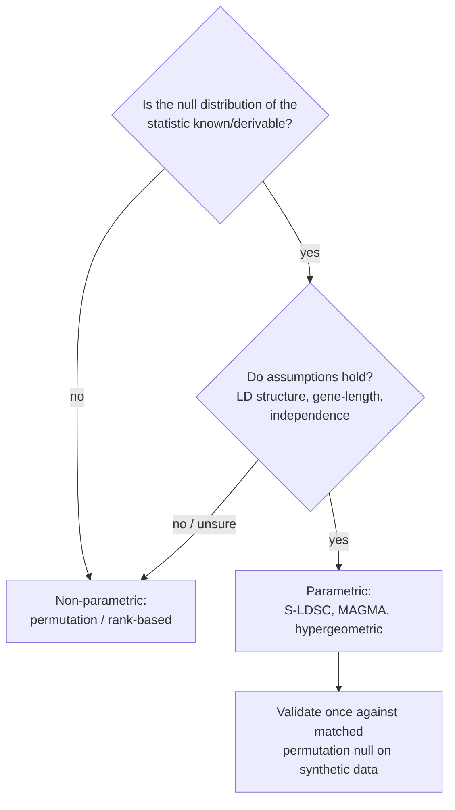

# Methods — Paper 2: Cross-Species Cell-Type Mapping

**Audience:** new contributors. This file states what is done, what is intended, every planned design decision with rationale, and the hygiene rules. References use the numbering of `docs/INTRODUCTION.md`.

## Done

Honest status: **this repository is at the scaffolding stage. No analysis has been run.**

- `src/` — data-free, in-memory utilities for ortholog mapping and concordance statistics (alignment scoring helpers operating on passed-in tables; no data files).
- `tests/` — synthetic-data tests for the alignment/concordance statistics (`python -m pytest -q` passes).
- `docs/` — this documentation set (status, introduction, methods, contribution guidance).
- Issue cards defining the planned work (linked below).

Nothing here touches real GWAS, atlas, or ortholog data yet. Any number in the docs describing biological findings (e.g., Paper 1's AD/PD enrichments) refers to the **foundation repo** `gwas-brain-celltype-heritability`, not to this repo.

## Intended

Planned pipeline, mapped to open issues:

| Step | Issue | Output |
|---|---|---|
| Build mouse cell-type gene programs + ortholog table | [#4](https://github.com/hwilner/gwas-cross-species-celltype-mapping/issues/4) | Versioned mouse marker sets at each taxonomy level; human↔mouse (and marmoset where available) one-to-one ortholog table from Ensembl Compara / HCOP. |
| Implement cross-species program alignment with synthetic tests | [#5](https://github.com/hwilner/gwas-cross-species-celltype-mapping/issues/5) | SAMap-style homology-confidence matrix between human and mouse cell types. |
| Run mouse-side heritability enrichment | [#2](https://github.com/hwilner/gwas-cross-species-celltype-mapping/issues/2) | Enrichment z-scores for ortholog-projected mouse programs against Paper 1's harmonized GWAS (S-LDSC [1], MAGMA [2], sc-linker-style [3]). |
| Cross-species concordance + human-specific map | [#3](https://github.com/hwilner/gwas-cross-species-celltype-mapping/issues/3) | Weighted rank correlations; FDR-controlled replication rates; flagged human-specific disease cell types. |
| Results package + manuscript outline | [#1](https://github.com/hwilner/gwas-cross-species-celltype-mapping/issues/1) | Frozen tables/figures. |

## Design decisions and rationale

### D1. Why gene-program projection instead of "mouse GWAS"
There is no mouse GWAS of human disease. GWAS variants are human variants. Conservation must therefore be tested by moving *gene sets* across species, not variants. Rationale: precedent in prior cross-species enrichment work [4,5]; keeps the entire Paper 1 statistical engine unchanged, so any difference in result is attributable to the gene set, not the method.

### D2. Alignment method: SAMap vs. ortholog-gene lifting vs. marker overlap — UNDECIDED, both options kept
This is the central open choice.

- **Option A: SAMap graph alignment [9].** Iteratively refines a joint embedding of the two atlases using a gene–gene homology graph, producing a soft alignment score per human–mouse type pair. *Pros:* uses the full transcriptome; yields continuous confidence; published cross-species track record. *Cons:* heavier to run; alignment can over-merge fine types; scores need calibration.
- **Option B: marker-overlap lifting.** Compute each mouse type's specific markers (exactly as Paper 1 computes specificity), lift to human orthologs, and score concordance directly through the enrichment results, with a simple Jaccard/hypergeometric check of marker overlap as the homology measure. *Pros:* transparent, cheap, perfectly matched to the enrichment test; no embedding artifacts. *Cons:* uses only top marker genes; coarser; sensitive to marker-count cutoffs.
- (The third variant, pure ortholog-gene lifting *without* an explicit homology matrix — i.e., compare enrichment profiles only — is the minimal fallback and is what Issue #2 strictly requires.)

**Selection rule:** implement marker-overlap (B) first as the baseline. If Paper 1's top human hits (AD: OPC, Vascular, Microglia; PD: CA4_197 cluster set) replicate in the ortholog-projected mouse programs with clean FDR-controlled significance, B is sufficient for the primary claims and SAMap (A) is reported as a sensitivity analysis on cortical types where fine-grained divergence is expected [8]. If B yields ambiguous or power-limited concordance, invest in A (Issue #5) and use its confidence scores as concordance weights.

### D3. Taxonomy level handling
All analyses run at every level of both taxonomies (class → subclass → supertype/cluster). Rationale: prior comparative work shows conservation is high at class level and degrades at fine levels [8]; we want to *locate the breakdown point*, not assume it. Per-level results are mandatory outputs.

### D4. Marmoset role
Marmoset is used only as a cortical bridge (human/marmoset/mouse motor cortex resource [8]) to check whether human–mouse divergence in cortical types is primate-wide or human-specific. Rationale: keeps scope bounded; marmoset whole-brain atlases at ABC resolution do not yet exist.

### D5. Concordance statistics
(i) Homology-confidence-weighted rank correlation of enrichment z-scores across paired types; (ii) FDR-controlled replication rate of significant human enrichments in mouse-homolog programs; (iii) human-specific flag = strong human enrichment + adequate mouse-side power + non-significant mouse homolog. Rationale: (i) is robust to calibration differences, (ii) answers the practical translational question, (iii) prevents underpowered mouse tests from masquerading as human specificity — a power floor is required before flagging.

## Parametric vs. non-parametric decision guide

**Parametric tests** assume the data (or the test statistic under the null) follow a specific distribution — e.g., S-LDSC's weighted least-squares regression of χ² statistics on LD scores [1], or a hypergeometric marker-overlap test. They are more powerful when assumptions hold, misleading when not.

**Non-parametric tests** make no distributional assumption — e.g., permutation of cell-type labels, rank correlations, sign tests. They are safer under unknown null behavior but usually need more data for the same power.

Concrete rules for this paper:

- **Enrichment tests (S-LDSC, MAGMA, sc-linker): parametric**, as in Paper 1 — their null models are established for GWAS summary statistics and validated in the foundation repo [1–3]. Rule: no re-tuning; identical settings to Paper 1 so cross-species comparisons are method-matched.
- **Marker-overlap homology scores: parametric hypergeometric**, because the null (random gene sets of the same size from the same ortholog universe) is exactly specified. Rule: background gene universe = genes expressed in both atlases with 1:1 orthologs, always stated.
- **Concordance across homolog pairs: non-parametric (weighted Spearman + permutation over type labels)**, because the null distribution of a confidence-weighted cross-species z-score correlation is not known analytically and depends on taxonomy tree correlation. Rule: ≥10,000 permutations, fixed seed, report permutation p alongside any parametric approximation.
- **When both exist and disagree, trust the non-parametric result** and investigate the assumption violation before publishing either.

## Hygiene rules

- **Genome builds.** GWAS summary statistics arrive in GRCh37 or GRCh38 depending on source; ABC Atlas annotations and Paper 1's pipeline are fixed to one build. **Any variant/annotation merge must be liftover-checked**: record source build per file, lift with a chain file, and verify post-lift variant counts and a spot-check of landmark loci (e.g., APOE region for AD) against Paper 1's harmonized inputs. Silent build mismatch is the classic way to manufacture fake nulls.
- **Ancestry bias.** GWAS are European-ancestry; LD references must match. Ortholog mapping is ancestry-neutral, but enrichment magnitudes are not — state the limitation wherever concordance numbers are reported.
- **Ortholog table versioning.** Pin the Ensembl Compara / HCOP release; store the raw download checksums (SHA-256); restrict to 1:1 orthologs for primary analyses, with many-to-many handled only in a labeled sensitivity analysis.
- **Reproducibility.** Every random step (permutations, alignments with random restarts) takes an explicit seed recorded in the run manifest. Checksums for all downloaded inputs go in `data/checksums.md` when data acquisition begins (Issue #4).
- **No data in git.** Large matrices stay out of the repository; only versioned pointers + checksums are committed.

## Validation plan before any real run

1. Synthetic end-to-end test: planted conserved enrichment must be recovered by the concordance statistic (extends existing `tests/`).
2. Negative control: a non-brain trait GWAS should show no brain cell-type concordance.
3. Build/liftover audit report committed alongside the first real enrichment table.

## References

See `docs/INTRODUCTION.md` for the full list. Most load-bearing here: [1] S-LDSC, [2] MAGMA, [3] sc-linker, [4] Bryois et al., [5] Skene et al., [6] human ABC Atlas, [7] mouse ABC Atlas, [8] human/marmoset/mouse motor cortex, [9] SAMap.
