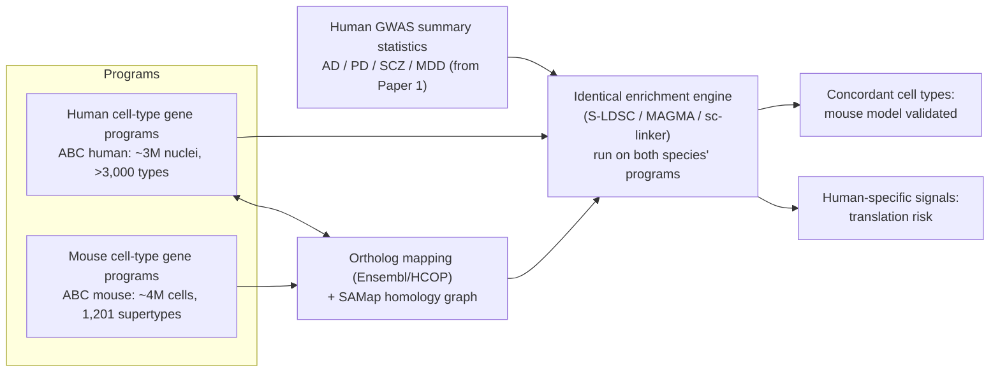

# Concept Figure — Paper 2: Cross-Species Conservation of Brain Cell-Type Heritability

> **Note:** A raster concept figure (`concept_figure.png`, 1536×1024, FigForge/NeurIPS flat-design style) was generated for this repository. Because the available GitHub tooling can only commit text content (verified: binary payloads are stored corrupted), the faithful figure is provided here as a Mermaid diagram that renders directly on GitHub. If `concept_figure.png` is later uploaded to this directory, it can be embedded as:
>
> ``

**Caption:** Concept figure — the Paper 2 design: human GWAS summary statistics meet human and mouse cell-type gene programs (aligned via orthologs and SAMap homology); the identical enrichment engine runs on both species' programs, and concordance analysis separates conserved cell types (valid mouse models) from human-specific signals (translation risk).

