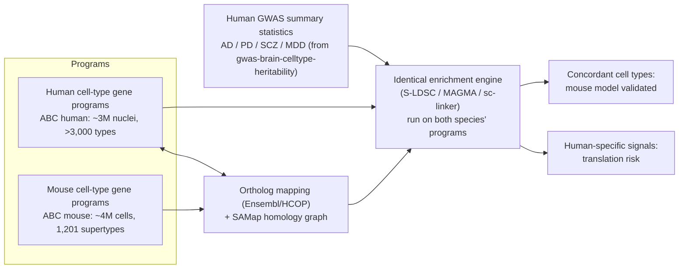

# Concept Figure — Cross-Species Conservation of Brain Cell-Type Heritability

> **Note.** The rendered concept figure is [`01-concept-schematic.png`](01-concept-schematic.png) in this folder — a generated scientific illustration. This file keeps the Mermaid source of the same diagram so it remains editable and re-renderable.

**Caption:** Concept figure — the design of this repository: human GWAS summary statistics meet human and mouse cell-type gene programs (aligned via orthologs and SAMap homology); the identical enrichment engine runs on both species' programs, and concordance analysis separates conserved cell types (valid mouse models) from human-specific signals (translation risk).

